# HER Beauty Studio & Social Enterprise — Non-Technical User Test Pack

**Project Name:** HER Beauty Studio & Social Enterprise  
**Date:** 18 April 2026  
**Director & Founder:** Mrs Monean N Jacobs (`founder@herbeauty.co.za`)  
**Flagship Studio:** 4 White Heart, Jamestown 7600 · Tel: `081 047 0327`  
**Official Logo File:** `C:\Users\Ricardo Smart\Desktop\H E R\presentation\her-logo-deck.png`  
**Design Reference:** `C:\Users\Ricardo Smart\Desktop\H E R\HER_Business_Plan.pptx`  
**Live System Link:** **http://localhost:5176**

---

## Quick Login Summary (All Test Roles)

| Role Group | Name | Email Address | Password | Starting Screen |
| :--- | :--- | :--- | :--- | :--- |
| **Platform Master & Governance** | Mrs Monean N Jacobs | **founder@herbeauty.co.za** | **ChangeMe123!** | **http://localhost:5176/master** |
| **Studio Director (Flagship)** | Chloe Laurent | **admin@herbeauty.co.za** | **Password123** | **http://localhost:5176/dashboard** |
| **Campus Hub Manager** | Thabo Mokoena | **tygervalley@herbeauty.co.za** | **Password123** | **http://localhost:5176/dashboard** |
| **Campus Hub Manager** | Ayesha Pillay | **rondebosch@herbeauty.co.za** | **Password123** | **http://localhost:5176/dashboard** |
| **Wellness & Academy Admins** | Pieter / Naledi / Riaan | **coetzenburg@** / **academy@** / **events@herbeauty.co.za** | **Password123** | **http://localhost:5176/dashboard** |
| **Head Mentor (EMPOWER · 50%)** | Nomvula Dlamini | **nomvula@herbeauty.co.za** | **Password123** | **http://localhost:5176/dashboard** |
| **Pathway Artisans (30%–45%)** | Zanele / Keisha / Lindiwe / Amahle | **zanele@** / **keisha@** / **lindiwe@** / **amahle@herbeauty.co.za** | **Password123** | **http://localhost:5176/dashboard** |
| **HER Circle VIP Student Client** | Thandiwe Ndlovu | **thandiwe@herbeauty.co.za** | **Password123** | **http://localhost:5176/my-bookings** |
| **Student Clients** | Sipho Khuzwayo / Anke van der Merwe | **sipho@herbeauty.co.za** / **anke@herbeauty.co.za** | **Password123** | **http://localhost:5176/my-bookings** |

> ⚠ **Before You Begin:** Open Microsoft Edge or Google Chrome and visit **http://localhost:5176**. Follow the numbered red circles (`1`, `2`, `3`) on each screenshot.

---

## Section 1: Platform Master & Executive Governance
**PowerPoint Pack:** `C:\Users\Ricardo Smart\Desktop\H E R\test pack\01_Platform_Master_and_Executive_Governance_Test_Pack.pptx`

### M-01: Login as Platform Master

**Step-by-Step Instructions:**
1. Open your web browser and go to **http://localhost:5176/login**.
2. Click the **Email** box (**1**) and enter **founder@herbeauty.co.za**.
3. Click the **Password** box (**2**) and enter **ChangeMe123!**.
4. Click **Log in** (**3**) to sign in.

**Annotated Screenshot (60%+ Slide Width Area):**  
- Local File Path: `C:\Users\Ricardo Smart\Desktop\H E R\test pack\screenshots\01_login_master.png`  
- Red Callouts on Screenshot: **(1)** Enter founder@herbeauty.co.za · **(2)** Enter Password · **(3)** Click "Log in"

**✓ Verification Criteria (What You Should See):**
- ✓ You sign in without any error message on screen.
- ✓ The top menu displays **Master Console**, **Simulator**, and **Audit**.
- ✓ Your name (**Mrs Monean N Jacobs**) appears in the top-right corner.
- ⚠ *Helpful Note:* Passwords are case-sensitive. Include the capital C, capital M, and exclamation mark in **ChangeMe123!**.

---

### M-02: Review Master Console & HER Pathway

**Step-by-Step Instructions:**
1. Click **Master Console** in the top navigation bar (or go to **http://localhost:5176/master**).
2. Locate the **+ Onboard Studio Hub** button (**1**) at the top right.
3. Review **The HER Pathway** dark espresso impact banner (**2**) across all 5 stages.
4. Check the four summary cards (**3**) showing active studios, team size, bookings, and revenue.

**Annotated Screenshot (60%+ Slide Width Area):**  
- Local File Path: `C:\Users\Ricardo Smart\Desktop\H E R\test pack\screenshots\02_master_console.png`  
- Red Callouts on Screenshot: **(1)** Click "+ Onboard Studio Hub" · **(2)** 5-Stage HER Pathway Metrics · **(3)** 6 Active Studios & KPI Cards
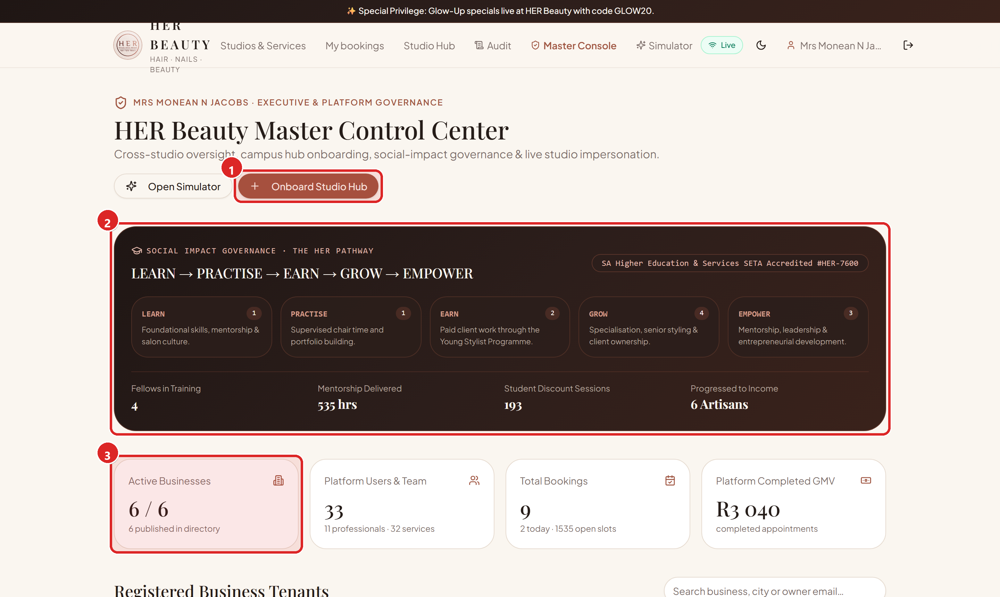

**✓ Verification Criteria (What You Should See):**
- ✓ You see **HER Beauty Master Control Center** under **Mrs Monean N Jacobs**.
- ✓ All 5 stages (**LEARN → PRACTISE → EARN → GROW → EMPOWER**) show fellow counts.
- ✓ **Active Businesses** displays **6 / 6** published Western Cape hubs.
- ⚠ *Helpful Note:* This executive screen gives leadership a single live view across every HER Beauty hub.

---

### M-03: Create a New Studio Hub

**Step-by-Step Instructions:**
1. On the **Master Console**, click **+ Onboard Studio Hub**.
2. Enter the new studio name in **Business Name** (**1**), such as **HER Beauty — Franschhoek Boutique**.
3. Select **Salon**, enter the city and manager name, and type the manager email in **Admin Email** (**2**).
4. Click **Onboard Business** (**3**) to create the studio (or **Cancel** if practising).

**Annotated Screenshot (60%+ Slide Width Area):**  
- Local File Path: `C:\Users\Ricardo Smart\Desktop\H E R\test pack\screenshots\03_create_studio_modal.png`  
- Red Callouts on Screenshot: **(1)** Enter New Studio Name · **(2)** Assign Studio Admin Email · **(3)** Click "Onboard Business"
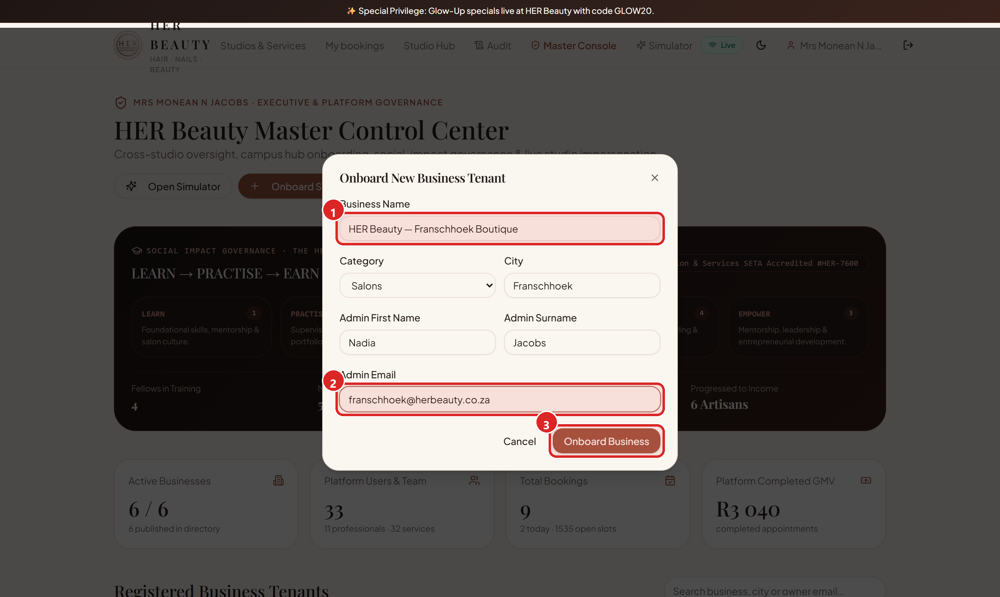

**✓ Verification Criteria (What You Should See):**
- ✓ The **Onboard New Business Tenant** window opens cleanly over the page.
- ✓ All studio and manager fields accept text clearly.
- ✓ When saved, the system displays a temporary login password for the new studio manager.
- ⚠ *Helpful Note:* Only **Platform Master** accounts can add new studio branches to the network.

---

### M-04: Manage Studio Directory & Status

**Step-by-Step Instructions:**
1. Scroll down to **Business Directory** on **http://localhost:5176/master**.
2. Locate **HER Beauty — Flagship Studio** (**1**) in Jamestown under owner **Chloe Laurent**.
3. Check the **Active** switch (**2**) next to the studio.
4. Click **Impersonate** (**3**) to step directly into that studio's dashboard.

**Annotated Screenshot (60%+ Slide Width Area):**  
- Local File Path: `C:\Users\Ricardo Smart\Desktop\H E R\test pack\screenshots\04_master_impersonate_list.png`  
- Red Callouts on Screenshot: **(1)** Flagship Studio Hub · **(2)** Active / Suspend Switch · **(3)** Click "Impersonate"
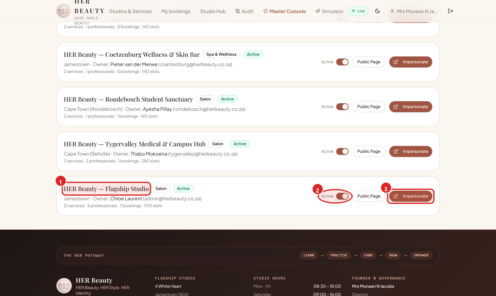

**✓ Verification Criteria (What You Should See):**
- ✓ All 6 HER Beauty hubs appear with green **Active** badges.
- ✓ Flagship Studio shows **21 services** and **5 professionals**.
- ✓ Clicking **Impersonate** opens the Flagship Studio dashboard immediately.
- ⚠ *Helpful Note:* Turning off **Active** pauses a studio's access immediately if governance action is ever needed.

---

### M-05: Step Into a Studio & Return Safely

**Step-by-Step Instructions:**
1. Look at the copper governance banner (**1**) across the very top of the screen.
2. Review the studio's live appointment figures (**3**) on the dashboard.
3. When finished reviewing, click **Return to Master Console** (**2**) at the top right.

**Annotated Screenshot (60%+ Slide Width Area):**  
- Local File Path: `C:\Users\Ricardo Smart\Desktop\H E R\test pack\screenshots\05_impersonation_active.png`  
- Red Callouts on Screenshot: **(1)** Active Impersonation Banner · **(2)** Return to Master Console · **(3)** Live Studio KPIs
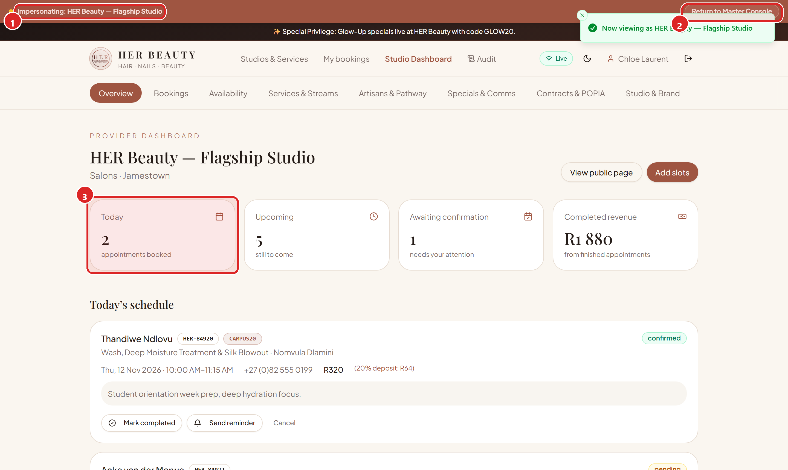

**✓ Verification Criteria (What You Should See):**
- ✓ The top bar clearly reads **Impersonating: HER Beauty — Flagship Studio**.
- ✓ You can inspect studio bookings, services, and contracts without needing a separate password.
- ✓ Clicking **Return to Master Console** brings you straight back to **/master**.
- ⚠ *Helpful Note:* Every studio support visit is recorded automatically in the platform activity history.

---

### M-06: Switch Roles in Platform Simulator

**Step-by-Step Instructions:**
1. Click **Simulator** (**1**) in the top navigation bar (or open **http://localhost:5176/demo**).
2. Browse the five pre-configured HER Beauty role cards, including **Chloe Laurent** (**2**).
3. Click **Launch Persona** (**3**) on **Chloe Laurent** or **Thandiwe Ndlovu** to preview their exact screen.

**Annotated Screenshot (60%+ Slide Width Area):**  
- Local File Path: `C:\Users\Ricardo Smart\Desktop\H E R\test pack\screenshots\06_platform_simulator.png`  
- Red Callouts on Screenshot: **(1)** Click "Simulator" in Top Menu · **(2)** Review Role Persona Card · **(3)** Click "Launch Persona" Button
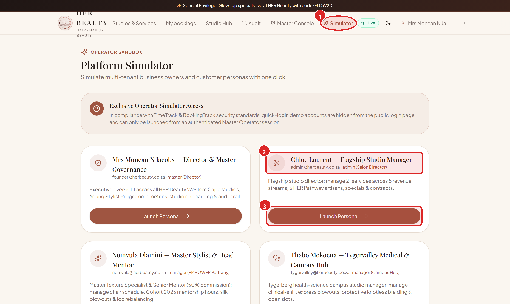

**✓ Verification Criteria (What You Should See):**
- ✓ Five role cards appear covering Director, Studio Manager, Head Mentor, Campus Hub, and VIP Client.
- ✓ One click switches into the chosen role with a top simulator banner.
- ✓ Quick-switch demo accounts remain hidden from the public sign-in page for security.
- ⚠ *Helpful Note:* Use **Return to Master Console** in the top banner whenever you want to exit Simulator mode.

---

### M-07: Inspect Activity History & Governance Log

**Step-by-Step Instructions:**
1. Click **Audit** (**1**) in the top navigation bar (or open **http://localhost:5176/audit**).
2. Type an email such as **founder@herbeauty.co.za** or **thandiwe@herbeauty.co.za** in the search bar (**2**).
3. Review the recorded activity cards (**3**) showing who performed each change and when.

**Annotated Screenshot (60%+ Slide Width Area):**  
- Local File Path: `C:\Users\Ricardo Smart\Desktop\H E R\test pack\screenshots\07_audit_trail.png`  
- Red Callouts on Screenshot: **(1)** Audit Menu · **(2)** Search Actor or Action · **(3)** Recorded Activity Entry
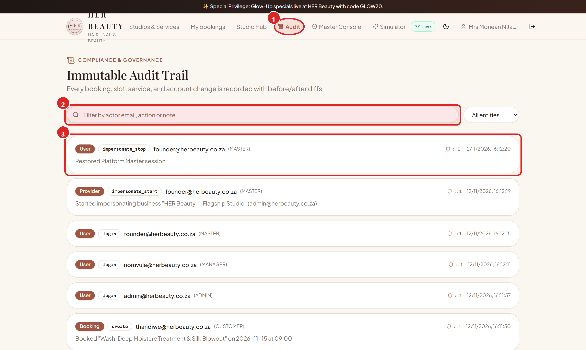

**✓ Verification Criteria (What You Should See):**
- ✓ The **Immutable Audit Trail** lists bookings, role switches, and studio updates.
- ✓ Each entry displays the category badge, action type, user email, and timestamp.
- ✓ Personal network details remain privacy-protected in compliance with POPIA.
- ⚠ *Helpful Note:* Activity records cannot be deleted or altered, giving leadership full accountability.

---

### M-08: Verify Platform Master Account & Profile (Mrs Monean N Jacobs)

**Step-by-Step Instructions:**
1. Click the **Sign out** icon at the top right, then open **http://localhost:5176/login**.
2. Enter email **founder@herbeauty.co.za** and password **ChangeMe123!**, then click **Log in**.
3. Click **Mrs Monean N Jacobs** in the top-right corner to open **Account & security** (**http://localhost:5176/profile**).
4. Check the **MASTER** role badge (**1**), confirmed email (**founder@herbeauty.co.za**) (**2**), and **Save details** button (**3**).

**Annotated Screenshot (60%+ Slide Width Area):**  
- Local File Path: `C:\Users\Ricardo Smart\Desktop\H E R\test pack\screenshots\08_ricardo_master_profile.png`  
- Red Callouts on Screenshot: **(1)** MASTER Governance Role · **(2)** founder@herbeauty.co.za · **(3)** Save Account Details
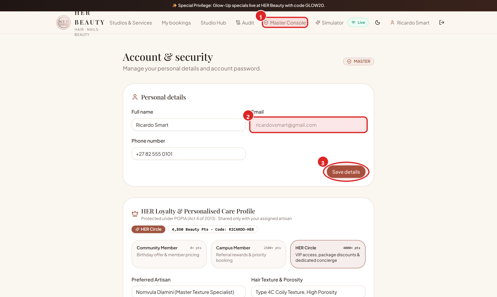

**✓ Verification Criteria (What You Should See):**
- ✓ **founder@herbeauty.co.za** signs in with full **MASTER** executive privileges.
- ✓ No legacy **@smartpatel.tech** accounts exist anywhere in the system.
- ✓ The Master account maintains the standard **ChangeMe123!** governance password.
- ⚠ *Helpful Note:* You can update phone details or change your password anytime from this security screen.

---

## Section 2: Studio Directors & Hub Admins
**PowerPoint Pack:** `C:\Users\Ricardo Smart\Desktop\H E R\test pack\02_Studio_Directors_and_Hub_Admins_Test_Pack.pptx`

### D-01: Login as Flagship Studio Director

**Step-by-Step Instructions:**
1. Open your browser and go to **http://localhost:5176/login**.
2. Enter **admin@herbeauty.co.za** in the **Email** field (**1**).
3. Enter **Password123** in the **Password** field (**2**).
4. Click **Log in** (**3**).

**Annotated Screenshot (60%+ Slide Width Area):**  
- Local File Path: `C:\Users\Ricardo Smart\Desktop\H E R\test pack\screenshots\09_login_director.png`  
- Red Callouts on Screenshot: **(1)** Enter admin@herbeauty.co.za · **(2)** Enter Password · **(3)** Click "Log in"

**✓ Verification Criteria (What You Should See):**
- ✓ You sign in smoothly as **Chloe Laurent** for **HER Beauty — Flagship Studio**.
- ✓ The top navigation displays **Studio Dashboard** and **Audit**.
- ✓ A green **Live** indicator appears in the top-right header.
- ⚠ *Helpful Note:* Campus Hub managers (such as **tygervalley@herbeauty.co.za**) also use **Password123**.

---

### D-02: Review Studio Dashboard & Today's Schedule

**Step-by-Step Instructions:**
1. Click **Studio Dashboard** in the top bar (or go to **http://localhost:5176/dashboard**).
2. Confirm the **Overview** tab (**1**) is active across the 8 studio management tabs.
3. Check the four daily summary cards (**2**): **Today**, **Upcoming**, **Awaiting confirmation**, and **Revenue**.
4. Inspect **Today's schedule** (**3**) for client bookings such as **HER-84920** and **HER-84922**.

**Annotated Screenshot (60%+ Slide Width Area):**  
- Local File Path: `C:\Users\Ricardo Smart\Desktop\H E R\test pack\screenshots\10_studio_dashboard_overview.png`  
- Red Callouts on Screenshot: **(1)** Overview Tab · **(2)** Studio KPI Cards · **(3)** Today's Client Schedule
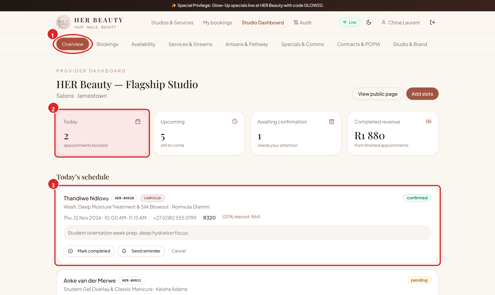

**✓ Verification Criteria (What You Should See):**
- ✓ You see **HER Beauty — Flagship Studio** and all four performance cards.
- ✓ Today's appointments show client name, time, assigned artisan, ZAR rate, and reference code.
- ✓ Action buttons (**Confirm**, **Complete**, **Cancel**) appear right on each appointment row.
- ⚠ *Helpful Note:* New client bookings appear on this screen automatically without refreshing the page.

---

### D-03: Confirm & Manage Client Bookings

**Step-by-Step Instructions:**
1. Click the **Bookings** tab (**1**) (or open **http://localhost:5176/dashboard/bookings**).
2. Click status filters (**2**) such as **Upcoming**, **Pending**, **Completed**, or **All**.
3. Locate a pending booking (**HER-84922**) and click **Confirm** (**3**) to approve the slot.

**Annotated Screenshot (60%+ Slide Width Area):**  
- Local File Path: `C:\Users\Ricardo Smart\Desktop\H E R\test pack\screenshots\11_studio_bookings.png`  
- Red Callouts on Screenshot: **(1)** Bookings Tab · **(2)** Filter by Status · **(3)** Confirm / Complete Appointment
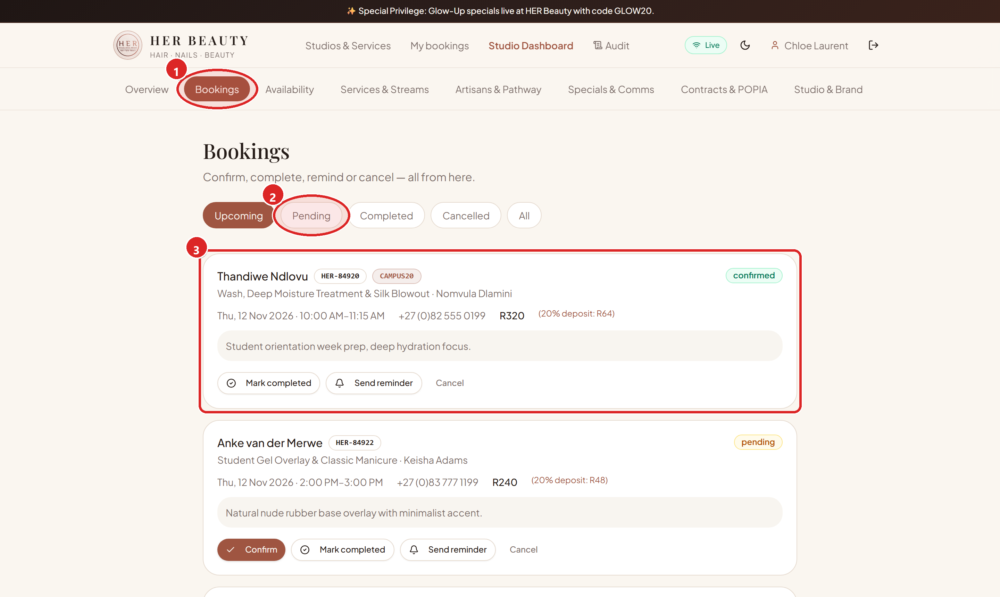

**✓ Verification Criteria (What You Should See):**
- ✓ Appointments filter cleanly by status pill.
- ✓ Each booking displays its **HER-** reference code, promo badge, and 20% deposit amount.
- ✓ Clicking **Confirm** updates the booking status badge to **confirmed** immediately.
- ⚠ *Helpful Note:* Cancelling a booking automatically frees that chair slot so another client can book it.

---

### D-04: Manage Services & 5 Revenue Streams

**Step-by-Step Instructions:**
1. Click the **Services & Streams** tab (**1**) (**http://localhost:5176/dashboard/services**).
2. Filter across the 5 revenue streams (**Salon**, **Packages**, **Retail**, **Training**, **Events**).
3. Click **+ Add service** (**2**) to inspect the service creation form.
4. Verify ZAR rates and the **Bookable** switch on service cards (**3**).

**Annotated Screenshot (60%+ Slide Width Area):**  
- Local File Path: `C:\Users\Ricardo Smart\Desktop\H E R\test pack\screenshots\12_studio_services.png`  
- Red Callouts on Screenshot: **(1)** Click "Services & Streams" Tab · **(2)** Click "+ Add service" · **(3)** Verify ZAR Rates & Bookable Switch
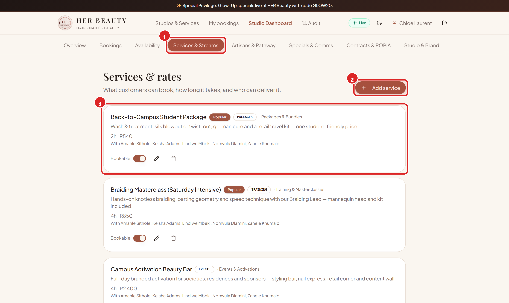

**✓ Verification Criteria (What You Should See):**
- ✓ Flagship Studio lists **21 services** across hair, braids, wigs, gel nails, facials, kits, and events.
- ✓ Prices appear clearly in South African Rand (e.g., **R 320**, **R 540**, **R 850**).
- ✓ Each service can be toggled bookable or edited with one click.
- ⚠ *Helpful Note:* Complimentary consultations display as **R 0 / Complimentary** with no deposit required.

---

### D-05: Manage Artisans & HER Pathway Stages

**Step-by-Step Instructions:**
1. Click the **Artisans & Pathway** tab (**1**) (**http://localhost:5176/dashboard/team**).
2. Review the 5-stage **HER Pathway** team directory.
3. Click **+ Add professional** (**2**) to see how new stylists or fellows are added.
4. Verify **Amahle Sithole** (**3**) and team cards for stage badges and commission rates.

**Annotated Screenshot (60%+ Slide Width Area):**  
- Local File Path: `C:\Users\Ricardo Smart\Desktop\H E R\test pack\screenshots\13_studio_artisans_pathway.png`  
- Red Callouts on Screenshot: **(1)** Click "Artisans & Pathway" Tab · **(2)** Click "+ Add professional" · **(3)** Check Pathway Stage & Commission
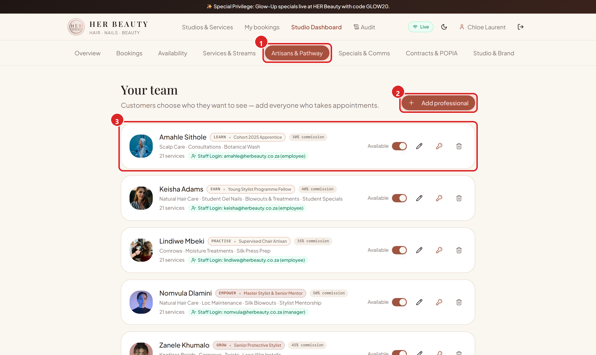

**✓ Verification Criteria (What You Should See):**
- ✓ All 5 Flagship artisans appear across **EMPOWER (50%)**, **GROW (45%)**, **EARN (40%)**, **PRACTISE (35%)**, and **LEARN (30%)**.
- ✓ Each card shows specialties, availability switch, edit pencil, and password reset option.
- ⚠ *Helpful Note:* Updating an artisan's Pathway stage automatically updates their badge on the public booking page.

---

### D-06: Open Studio Chair Time Slots

**Step-by-Step Instructions:**
1. Click the **Availability** tab (**1**) (**http://localhost:5176/dashboard/availability**).
2. Select an artisan such as **Amahle Sithole** under **Professional** (**2**).
3. Pick a date, start/end time, slot length (**30 minutes**), and click **Add slots** (**3**).

**Annotated Screenshot (60%+ Slide Width Area):**  
- Local File Path: `C:\Users\Ricardo Smart\Desktop\H E R\test pack\screenshots\14_studio_availability.png`  
- Red Callouts on Screenshot: **(1)** Click "Availability" Tab · **(2)** Choose Artisan, Date & Time Range · **(3)** Click "Add slots"
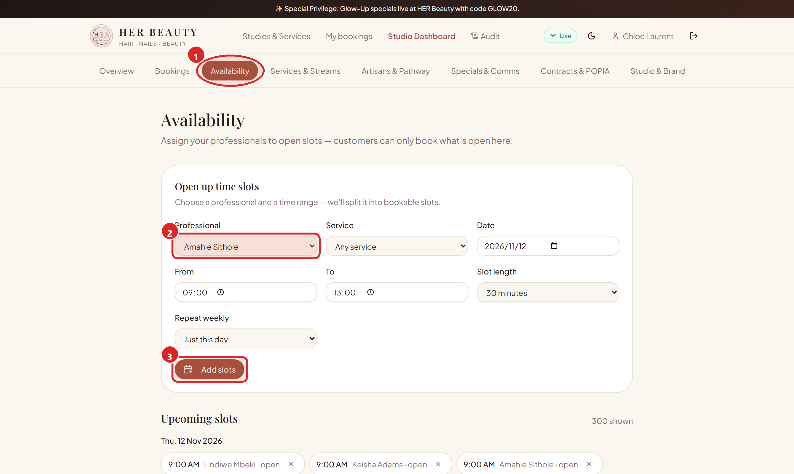

**✓ Verification Criteria (What You Should See):**
- ✓ The **Open up time slots** tool splits your chosen hours into bookable appointment slots.
- ✓ Open slots appear grouped by date across the 14-day calendar strip below.
- ✓ Booked slots are protected from accidental deletion.
- ⚠ *Helpful Note:* Use **Repeat** (1, 2, 4, or 8 weeks) to publish an entire month's chair roster in seconds.

---

### D-07: Publish Specials & Send Broadcasts

**Step-by-Step Instructions:**
1. Click the **Specials & Comms** tab (**1**) (**http://localhost:5176/dashboard/specials**).
2. Click **+ New Campus Special** (**2**) to view how promotional codes are published.
3. Verify active offers (**3**) including **CAMPUS20 (20% OFF)**, **WELCOME15**, and **GLOW25**.
4. Scroll down to check the **Send Studio Broadcast** panel for client or stylist announcements.

**Annotated Screenshot (60%+ Slide Width Area):**  
- Local File Path: `C:\Users\Ricardo Smart\Desktop\H E R\test pack\screenshots\15_studio_specials_comms.png`  
- Red Callouts on Screenshot: **(1)** Click "Specials & Comms" Tab · **(2)** Click "New Campus Special" · **(3)** Verify CAMPUS20 Offer Card
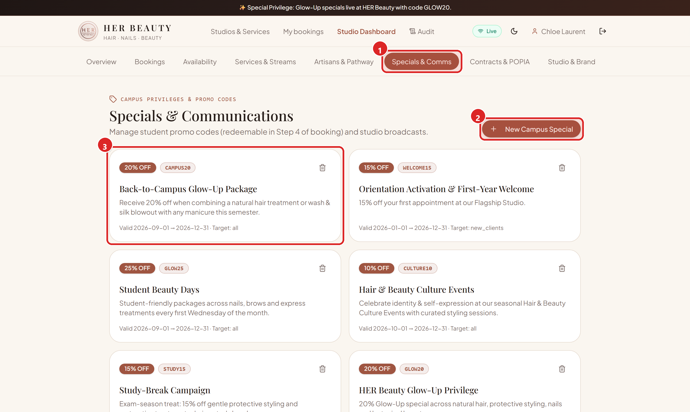

**✓ Verification Criteria (What You Should See):**
- ✓ All active campus specials display discount percentages and validity dates.
- ✓ Sent announcements appear in the broadcast log and record in activity history.
- ⚠ *Helpful Note:* Any promo code created here works immediately during Step 4 of client checkout.

---

### D-08: Verify Artisan Contracts, Cohort 2025 & POPIA

**Step-by-Step Instructions:**
1. Click the **Contracts & POPIA** tab (**1**) (**http://localhost:5176/dashboard/contracts**).
2. Click **+ Issue Artisan Contract** (**2**) to inspect the learnership/stylist agreement form.
3. Review the **HER Booking & POPIA Policy** card (**3**), **Cohort 2025**, and **Stylist Contracts**.

**Annotated Screenshot (60%+ Slide Width Area):**  
- Local File Path: `C:\Users\Ricardo Smart\Desktop\H E R\test pack\screenshots\16_studio_contracts_popia.png`  
- Red Callouts on Screenshot: **(1)** Click "Contracts & POPIA" Tab · **(2)** Click "Issue Artisan Contract" · **(3)** Review Artisan Contract & 50% Commission
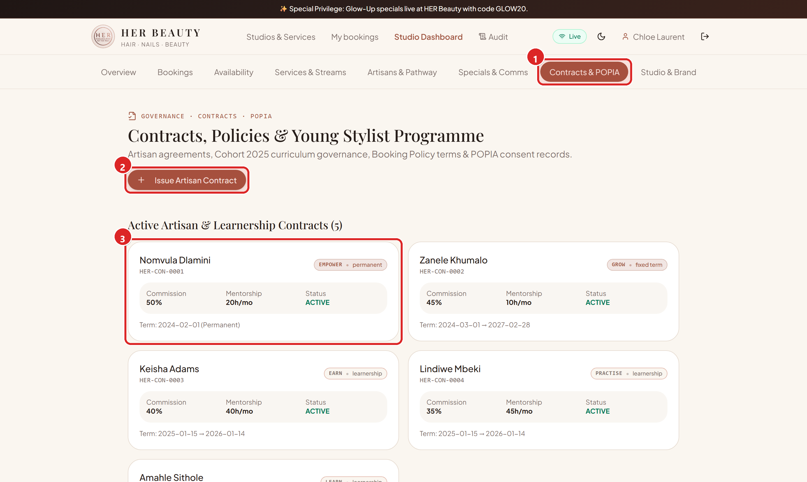

**✓ Verification Criteria (What You Should See):**
- ✓ Policy terms clearly show **20% deposit**, **24 hrs** cancellation, **50%** no-show fee, and **14 days** retail return.
- ✓ Cohort 2025 lists all 7 training modules and the **R 2 500** monthly fellow stipend.
- ✓ Signed contracts (**HER-CON-0001** to **HER-CON-0005**) and client POPIA consents are listed.
- ⚠ *Helpful Note:* This tab keeps employment governance and client privacy records audit-ready in one place.

---

### D-09: Update Studio Profile & Public Visibility

**Step-by-Step Instructions:**
1. Click the **Studio & Brand** tab (**1**) (**http://localhost:5176/dashboard/profile**).
2. Verify the **Taking bookings** visibility switch (**2**) is turned on.
3. Check the Jamestown address (**4 White Heart, Jamestown, 7600**) and opening hours.
4. Click **Preview public page** (**3**) to view the studio exactly as clients see it.

**Annotated Screenshot (60%+ Slide Width Area):**  
- Local File Path: `C:\Users\Ricardo Smart\Desktop\H E R\test pack\screenshots\17_studio_brand_profile.png`  
- Red Callouts on Screenshot: **(1)** Studio & Brand Tab · **(2)** Public Search Visibility · **(3)** Preview Public Studio Page
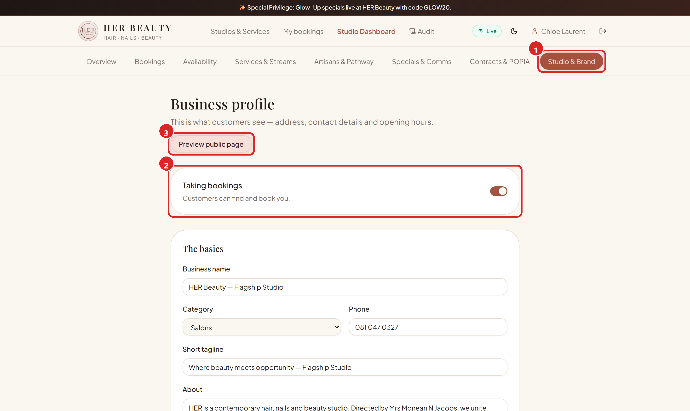

**✓ Verification Criteria (What You Should See):**
- ✓ The studio shows **Taking bookings** so clients can discover it in search.
- ✓ Contact details (**081 047 0327**, **founder@herbeauty.co.za**) and Mon–Sat hours match brand standards.
- ⚠ *Helpful Note:* Switching off **Taking bookings** hides a hub from public search during renovations or training days.

---

## Section 3: Artisans & Mentors (The HER Pathway)
**PowerPoint Pack:** `C:\Users\Ricardo Smart\Desktop\H E R\test pack\03_Artisans_and_Mentors_HER_Pathway_Test_Pack.pptx`

### A-01: Login as Head Mentor & Master Stylist

**Step-by-Step Instructions:**
1. Open your browser and go to **http://localhost:5176/login**.
2. Enter **nomvula@herbeauty.co.za** in the **Email** box (**1**).
3. Enter **Password123** in the **Password** box (**2**).
4. Click **Log in** (**3**).

**Annotated Screenshot (60%+ Slide Width Area):**  
- Local File Path: `C:\Users\Ricardo Smart\Desktop\H E R\test pack\screenshots\18_login_artisan.png`  
- Red Callouts on Screenshot: **(1)** Enter nomvula@herbeauty.co.za · **(2)** Enter Password · **(3)** Click "Log in"
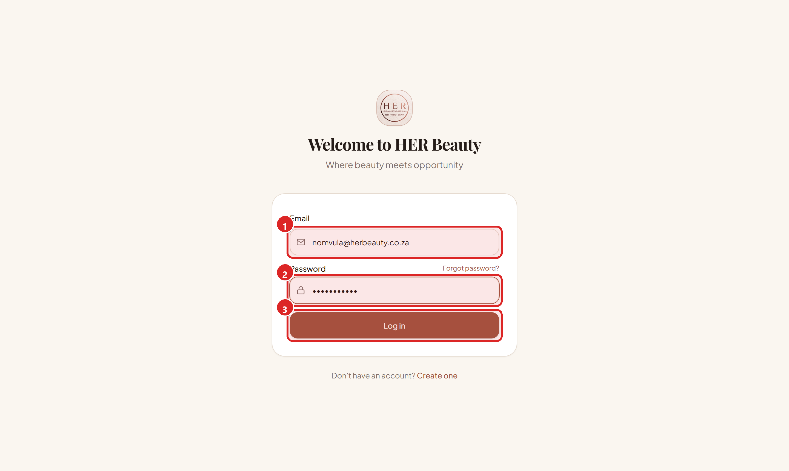

**✓ Verification Criteria (What You Should See):**
- ✓ You sign in as **Nomvula Dlamini** (Master Stylist & Senior Mentor).
- ✓ The header displays **Studio Dashboard**, **Audit**, and **Nomvula Dlamini**.
- ⚠ *Helpful Note:* Other Pathway artisans (**zanele@**, **keisha@**, **lindiwe@**, **amahle@herbeauty.co.za**) also use **Password123**.

---

### A-02: Check Daily Chair Schedule & Live Updates

**Step-by-Step Instructions:**
1. Click **Studio Dashboard** (**http://localhost:5176/dashboard**).
2. Confirm **Nomvula Dlamini** (**1**) and the green **Live** badge (**2**) in the top-right header.
3. Review **Today's schedule** (**3**) for **HER-84920** (**Thandiwe Ndlovu · Wash, Deep Moisture Treatment & Silk Blowout**).

**Annotated Screenshot (60%+ Slide Width Area):**  
- Local File Path: `C:\Users\Ricardo Smart\Desktop\H E R\test pack\screenshots\19_artisan_schedule_view.png`  
- Red Callouts on Screenshot: **(1)** Signed In as Nomvula Dlamini · **(2)** Green Live Updates Badge · **(3)** Assigned Client Appointment (HER-84920)
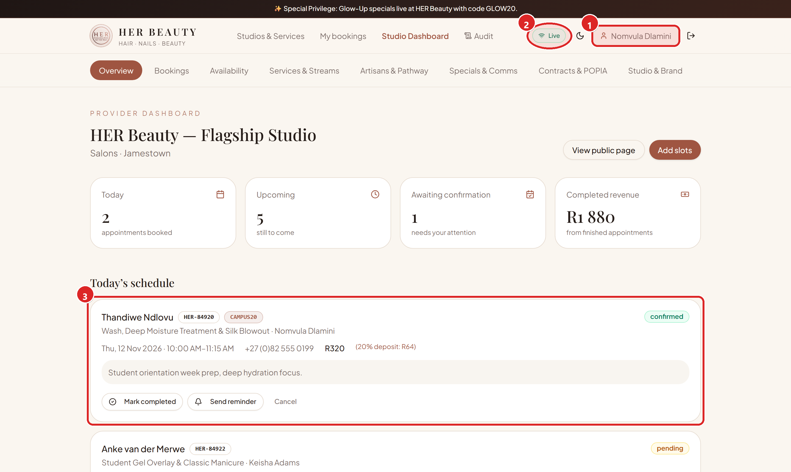

**✓ Verification Criteria (What You Should See):**
- ✓ Your assigned client appointment shows exact time (**10:00 AM–11:15 AM**), service, and client notes.
- ✓ The green **Live** badge confirms instant chair alerts when clients book or cancel.
- ⚠ *Helpful Note:* Client texture and care notes appear right on the booking row so you can prepare products beforehand.

---

### A-03: Confirm & Complete Chair Appointments

**Step-by-Step Instructions:**
1. Click the **Bookings** tab (**1**) (**http://localhost:5176/dashboard/bookings**).
2. Use **Upcoming** or **Pending** (**2**) to filter appointments waiting for attention.
3. Click **Confirm** or **Complete** (**3**) once a client's hair, nail, or beauty session finishes.

**Annotated Screenshot (60%+ Slide Width Area):**  
- Local File Path: `C:\Users\Ricardo Smart\Desktop\H E R\test pack\screenshots\11_studio_bookings.png`  
- Red Callouts on Screenshot: **(1)** Bookings Tab · **(2)** Filter by Status · **(3)** Confirm / Complete Appointment

**✓ Verification Criteria (What You Should See):**
- ✓ Pending appointments (**HER-84922**) show clear **Confirm** and **Cancel** buttons.
- ✓ Marking a session **Complete** adds its ZAR value into completed studio revenue.
- ⚠ *Helpful Note:* Completing sessions accurately ensures artisan commission and mentorship records stay exact.

---

### A-04: Verify Pathway Stage & Commission Tier

**Step-by-Step Instructions:**
1. Click the **Artisans & Pathway** tab (**1**) (**http://localhost:5176/dashboard/team**).
2. Check the 5-stage **HER Pathway** bar from **LEARN** through **EMPOWER**.
3. Inspect **Nomvula Dlamini** (**3**) and fellow cards (**Keisha**, **Lindiwe**, **Amahle**).

**Annotated Screenshot (60%+ Slide Width Area):**  
- Local File Path: `C:\Users\Ricardo Smart\Desktop\H E R\test pack\screenshots\13_studio_artisans_pathway.png`  
- Red Callouts on Screenshot: **(1)** Click "Artisans & Pathway" Tab · **(2)** Click "+ Add professional" · **(3)** Check Pathway Stage & Commission

**✓ Verification Criteria (What You Should See):**
- ✓ **Nomvula Dlamini** displays **EMPOWER** stage at **50% comm.**
- ✓ **Zanele (GROW 45%)**, **Keisha (EARN 40%)**, **Lindiwe (PRACTISE 35%)**, and **Amahle (LEARN 30%)** appear clearly.
- ⚠ *Helpful Note:* Every stage reflects transparent progression from Cohort 2025 apprentice to Master Mentor.

---

### A-05: Publish Open Chair Slots for Clients

**Step-by-Step Instructions:**
1. Click the **Availability** tab (**1**) (**http://localhost:5176/dashboard/availability**).
2. Select your name under **Professional** (**2**) and pick your working date and hours.
3. Click **Add slots** (**3**) to open chair times for student and community bookings.

**Annotated Screenshot (60%+ Slide Width Area):**  
- Local File Path: `C:\Users\Ricardo Smart\Desktop\H E R\test pack\screenshots\14_studio_availability.png`  
- Red Callouts on Screenshot: **(1)** Click "Availability" Tab · **(2)** Choose Artisan, Date & Time Range · **(3)** Click "Add slots"

**✓ Verification Criteria (What You Should See):**
- ✓ New 30-minute or 60-minute slots appear immediately in the open slots grid below.
- ✓ Clients can now select those exact times in Step 3 of online booking.
- ⚠ *Helpful Note:* Approved conference or study leave dates are respected so clients never double-book you.

---

### A-06: Review Stylist Notices & Specials

**Step-by-Step Instructions:**
1. Click the **Specials & Comms** tab (**1**) (**http://localhost:5176/dashboard/specials**).
2. Check active student promotions (**3**) such as **CAMPUS20** so you can advise walk-in clients.
3. Read the **Recent Broadcasts** feed on the right for Saturday roster and mentorship updates.

**Annotated Screenshot (60%+ Slide Width Area):**  
- Local File Path: `C:\Users\Ricardo Smart\Desktop\H E R\test pack\screenshots\15_studio_specials_comms.png`  
- Red Callouts on Screenshot: **(1)** Click "Specials & Comms" Tab · **(2)** Click "New Campus Special" · **(3)** Verify CAMPUS20 Offer Card

**✓ Verification Criteria (What You Should See):**
- ✓ Stylist notices (such as **Updated Young Stylist Mentorship & Saturday Shift Rosters**) are visible.
- ✓ Active promo codes and discount rates are clearly listed.
- ⚠ *Helpful Note:* Head Mentors (`manager` role) can also send team reminders directly from the Broadcasts panel.

---

### A-07: Check Artisan Contract & Mentorship Hours

**Step-by-Step Instructions:**
1. Click the **Contracts & POPIA** tab (**1**) (**http://localhost:5176/dashboard/contracts**).
2. Scroll to **Young Stylist Programme — Cohort 2025** and **Stylist Contracts**.
3. Verify contract reference (**HER-CON-0001** to **HER-CON-0005**), commission %, and monthly mentorship hours.

**Annotated Screenshot (60%+ Slide Width Area):**  
- Local File Path: `C:\Users\Ricardo Smart\Desktop\H E R\test pack\screenshots\16_studio_contracts_popia.png`  
- Red Callouts on Screenshot: **(1)** Click "Contracts & POPIA" Tab · **(2)** Click "Issue Artisan Contract" · **(3)** Review Artisan Contract & 50% Commission

**✓ Verification Criteria (What You Should See):**
- ✓ Cohort 2025 shows mentors (**Nomvula Dlamini**, **Zanele Khumalo**) and enrolled fellows.
- ✓ Each artisan's signed contract type, commission rate, and monthly mentorship hours are transparent.
- ⚠ *Helpful Note:* Learnership fellows receive 40–60 structured mentorship hours per month plus their R 2 500 stipend.

---

### A-08: Verify Public Artisan Portfolio & Badge

**Step-by-Step Instructions:**
1. Click **Studios & Services** in the top menu, then open **HER Beauty — Flagship Studio**.
2. Scroll down to the studio's **Artisans** showcase section.
3. Check the public profile cards for **Nomvula** (**1**), **Zanele** (**2**), and **Keisha** (**3**).

**Annotated Screenshot (60%+ Slide Width Area):**  
- Local File Path: `C:\Users\Ricardo Smart\Desktop\H E R\test pack\screenshots\20_artisan_public_showcase.png`  
- Red Callouts on Screenshot: **(1)** Amahle · LEARN Apprentice · **(2)** Keisha · EARN Fellow · **(3)** Nomvula · EMPOWER Mentor
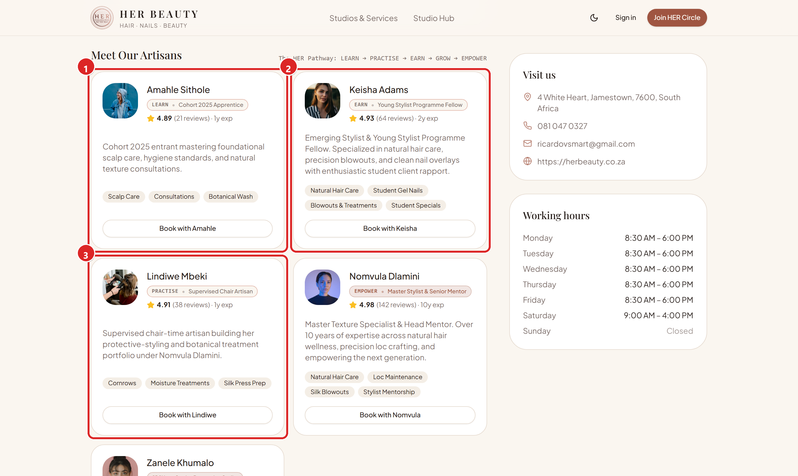

**✓ Verification Criteria (What You Should See):**
- ✓ Each artisan's photo, bio, specialties, star rating (**4.9+**), and **HER Pathway** badge appear proudly.
- ✓ Clients can see whether they are booking a Master Mentor or supporting an emerging Young Stylist Fellow.
- ⚠ *Helpful Note:* Public Pathway badges celebrate youth progression and build strong client trust.

---

## Section 4: Client & Student Accounts
**PowerPoint Pack:** `C:\Users\Ricardo Smart\Desktop\H E R\test pack\04_Client_and_Student_Accounts_Test_Pack.pptx`

### C-01: Browse Studios & Glow-Up Banner

**Step-by-Step Instructions:**
1. Open your browser and go to **http://localhost:5176**.
2. Check the top announcement bar (**1**) featuring promo code **GLOW20**.
3. Type **Flagship** or **Braids** in the search box (**2**) or click **Salon** (**3**) to filter.

**Annotated Screenshot (60%+ Slide Width Area):**  
- Local File Path: `C:\Users\Ricardo Smart\Desktop\H E R\test pack\screenshots\21_home_browse.png`  
- Red Callouts on Screenshot: **(1)** Check GLOW20 Privilege Banner · **(2)** Search Studios or Treatments · **(3)** Filter by Beauty Category
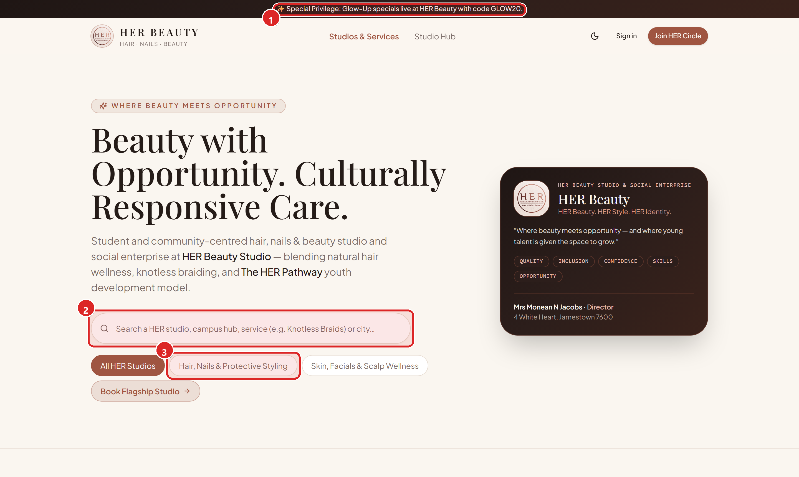

**✓ Verification Criteria (What You Should See):**
- ✓ The luxury **HER Beauty** home page loads with the **GLOW20** special privilege banner.
- ✓ All 6 published Western Cape HER Beauty studios appear with ratings and city locations.
- ✓ Footer displays **HER Beauty. HER Style. HER Identity.** and **Where beauty meets opportunity**.
- ⚠ *Helpful Note:* Anyone can browse studios, prices, and artisans freely before signing in.

---

### C-02: Explore Flagship Studio & ZAR Menu

**Step-by-Step Instructions:**
1. Click **HER Beauty — Flagship Studio** on the home page.
2. Verify the studio title (**1**) and Jamestown address (**4 White Heart, Jamestown**) (**3**).
3. Browse the 21 services and click **Book an appointment** (**2**).

**Annotated Screenshot (60%+ Slide Width Area):**  
- Local File Path: `C:\Users\Ricardo Smart\Desktop\H E R\test pack\screenshots\22_studio_public_page.png`  
- Red Callouts on Screenshot: **(1)** Flagship Studio & Location · **(2)** Click "Book an appointment" · **(3)** Jamestown Address & Hours
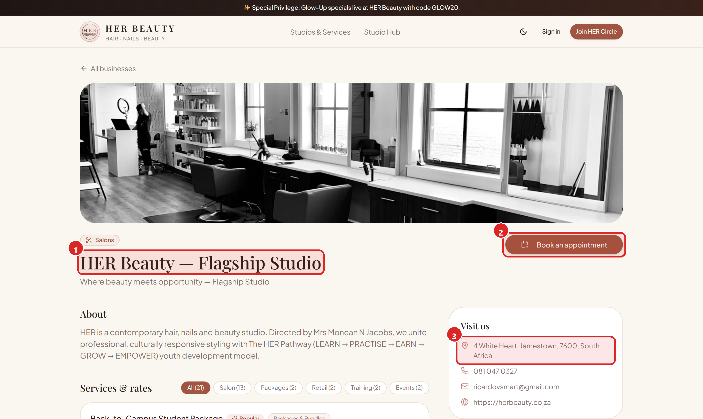

**✓ Verification Criteria (What You Should See):**
- ✓ Opening hours (**Mon–Fri 08:30–18:00, Sat 09:00–16:00**), phone (**081 047 0327**), and ZAR prices appear.
- ✓ Clicking **Book an appointment** launches the 4-step booking wizard.
- ⚠ *Helpful Note:* You can filter services by stream (Salon, Packages, Retail, Training, Events) on this page.

---

### C-03: Login as VIP Student Client

**Step-by-Step Instructions:**
1. Click **Sign in** at the top right (or go to **http://localhost:5176/login**).
2. Enter **thandiwe@herbeauty.co.za** in the **Email** box (**1**).
3. Enter **Password123** in the **Password** box (**2**) and click **Log in** (**3**).

**Annotated Screenshot (60%+ Slide Width Area):**  
- Local File Path: `C:\Users\Ricardo Smart\Desktop\H E R\test pack\screenshots\23_login_client.png`  
- Red Callouts on Screenshot: **(1)** Enter thandiwe@herbeauty.co.za · **(2)** Enter Password · **(3)** Click "Log in"

**✓ Verification Criteria (What You Should See):**
- ✓ You sign in as **Thandiwe Ndlovu**.
- ✓ **My bookings** and **Thandiwe Ndlovu** appear in the top navigation bar.
- ⚠ *Helpful Note:* Additional student test logins (**sipho@herbeauty.co.za** and **anke@herbeauty.co.za**) also use **Password123**.

---

### C-04: Booking Step 1: Choose a Service

**Step-by-Step Instructions:**
1. Inside **HER Beauty — Flagship Studio**, click **Book an appointment**.
2. Click **Wash, Deep Moisture Treatment & Silk Blowout** (**1**) (**75 min · R 320**).
3. Compare other services (**2**) if desired, then click **Continue** (**3**).

**Annotated Screenshot (60%+ Slide Width Area):**  
- Local File Path: `C:\Users\Ricardo Smart\Desktop\H E R\test pack\screenshots\24_book_step1_service.png`  
- Red Callouts on Screenshot: **(1)** Select Silk Blowout (R 320) · **(2)** Compare Services & ZAR Rates · **(3)** Click "Continue"
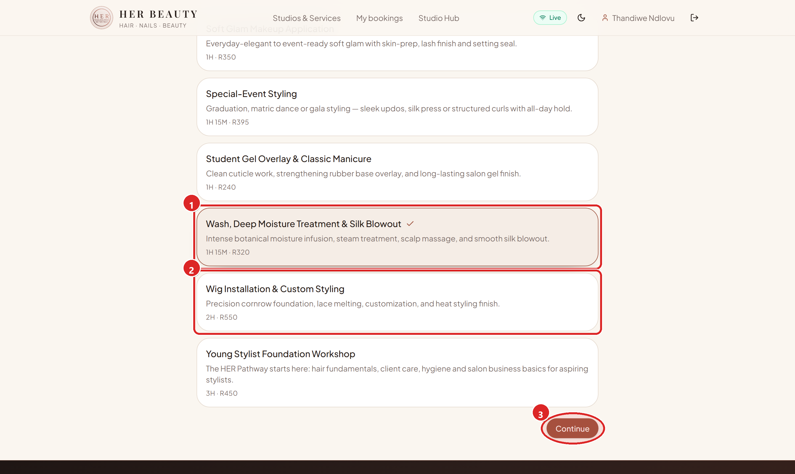

**✓ Verification Criteria (What You Should See):**
- ✓ Your chosen service card highlights with a checkmark.
- ✓ Duration and ZAR price are clearly displayed on every service option.
- ✓ The **Continue** button activates as soon as a service is selected.
- ⚠ *Helpful Note:* You cannot accidentally skip Step 1 because **Continue** stays disabled until you choose a service.

---

### C-05: Booking Step 2: Select Preferred Artisan

**Step-by-Step Instructions:**
1. Review **Any available artisan** or pick a specific stylist.
2. Click **Nomvula Dlamini** (**1**) to book with the Master Stylist & Senior Mentor.
3. Notice the **HER Pathway** badges (**2**) on every artisan, then click **Continue** (**3**).

**Annotated Screenshot (60%+ Slide Width Area):**  
- Local File Path: `C:\Users\Ricardo Smart\Desktop\H E R\test pack\screenshots\25_book_step2_artisan.png`  
- Red Callouts on Screenshot: **(1)** Select Nomvula Dlamini (EMPOWER) · **(2)** Compare Pathway Stage Badges · **(3)** Click "Continue"
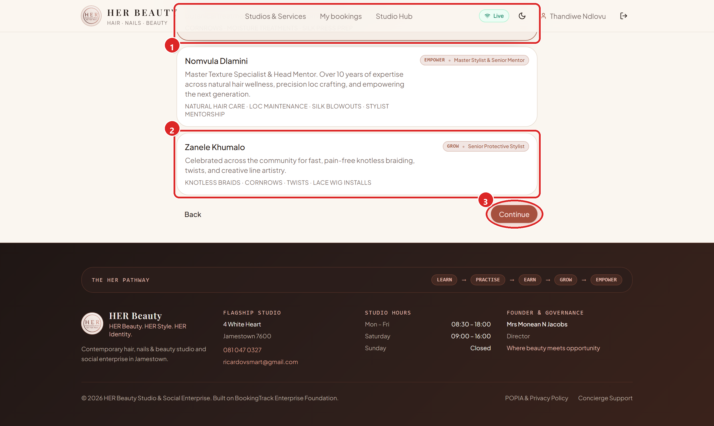

**✓ Verification Criteria (What You Should See):**
- ✓ **Nomvula Dlamini** shows a selected checkmark and her **EMPOWER** badge.
- ✓ Specialties (Natural Hair Care, Loc Maintenance, Silk Blowouts) are clearly listed.
- ⚠ *Helpful Note:* Choosing **Any available artisan** automatically assigns whoever is open at your chosen time.

---

### C-06: Booking Step 3: Pick Date & Chair Slot

**Step-by-Step Instructions:**
1. Select your preferred date (**1**) across the 14-day calendar strip.
2. Click an open time button (**2**) such as **9:00 AM**.
3. Click **Continue** (**3**) to proceed to confirmation.

**Annotated Screenshot (60%+ Slide Width Area):**  
- Local File Path: `C:\Users\Ricardo Smart\Desktop\H E R\test pack\screenshots\26_book_step3_slot.png`  
- Red Callouts on Screenshot: **(1)** Pick Preferred Date · **(2)** Select Open Chair Slot · **(3)** Click "Continue"
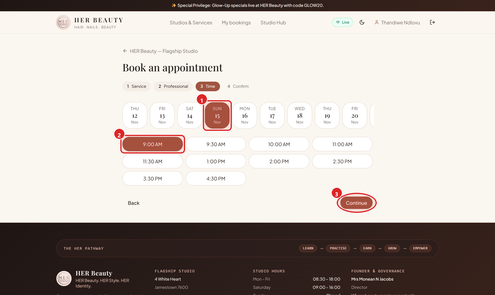

**✓ Verification Criteria (What You Should See):**
- ✓ Only genuinely open chair times appear — already-booked times are hidden.
- ✓ The selected date and time button highlight in rich espresso/copper.
- ⚠ *Helpful Note:* If all slots are taken on one day, click the next date in the 14-day strip.

---

### C-07: Booking Step 4: Apply Promo & Accept POPIA

**Step-by-Step Instructions:**
1. Type **CAMPUS20** (or **GLOW20**) in the promo box and click **Apply** (**1**).
2. Add any optional hair texture, skin, or allergy notes for your artisan.
3. Tick both the **HER Booking Policy** (20% deposit) and **POPIA** consent boxes (**2**).
4. Click **Confirm booking** (**3**).

**Annotated Screenshot (60%+ Slide Width Area):**  
- Local File Path: `C:\Users\Ricardo Smart\Desktop\H E R\test pack\screenshots\27_book_step4_promo_popia.png`  
- Red Callouts on Screenshot: **(1)** Enter Promo Code "CAMPUS20" & Apply · **(2)** Tick 20% Deposit Policy & POPIA Boxes · **(3)** Click "Confirm booking"
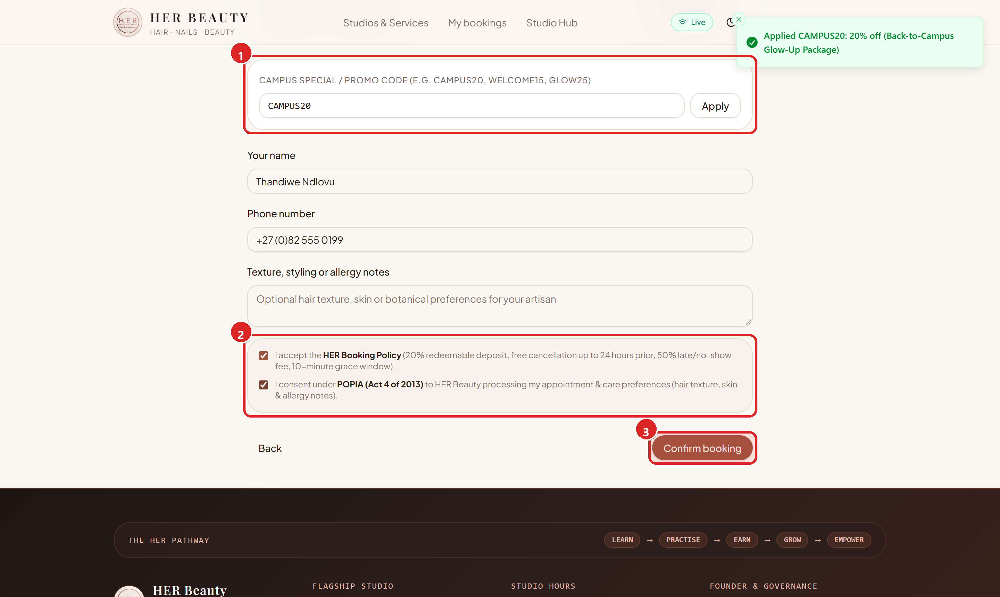

**✓ Verification Criteria (What You Should See):**
- ✓ Price updates automatically from **R 320** to **R 256 (20% off with CAMPUS20)**.
- ✓ The redeemable **20% Deposit: R 51.20** badge calculates automatically.
- ✓ **Confirm booking** unlocks only after both policy and POPIA boxes are ticked.
- ⚠ *Helpful Note:* Try codes **CAMPUS20**, **GLOW20**, **WELCOME15**, or **GLOW25** to verify instant discounts.

---

### C-08: Verify Booking Receipt & Reference Code

**Step-by-Step Instructions:**
1. Review the **You're booked in** confirmation screen.
2. Check your unique **Booking Reference** badge (**1**) (for example, **HER-36518**).
3. Verify the **Applied Promo** and **20% Booking Policy Deposit** summary (**2**).
4. Click **View my bookings** (**3**).

**Annotated Screenshot (60%+ Slide Width Area):**  
- Local File Path: `C:\Users\Ricardo Smart\Desktop\H E R\test pack\screenshots\28_book_confirmed_receipt.png`  
- Red Callouts on Screenshot: **(1)** Unique HER Reference Code · **(2)** 20% Deposit & Discount Summary · **(3)** Click "View my bookings"
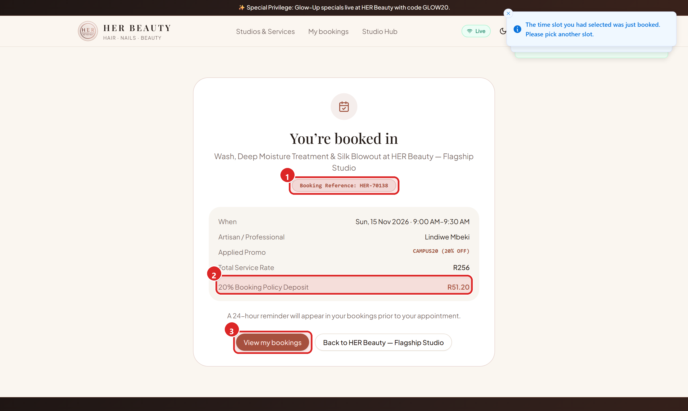

**✓ Verification Criteria (What You Should See):**
- ✓ A unique **HER-** reference code is generated immediately.
- ✓ Date, time, artisan (**Nomvula Dlamini**), discounted rate (**R 256**), and deposit (**R 51.20**) match.
- ⚠ *Helpful Note:* Keep your **HER-** reference code handy when arriving at 4 White Heart, Jamestown.

---

### C-09: Check My Bookings & HER Circle Loyalty

**Step-by-Step Instructions:**
1. Review your upcoming appointments and reminder banner on **My bookings** (**http://localhost:5176/my-bookings**).
2. Click **Thandiwe Ndlovu** at the top right to open **http://localhost:5176/profile**.
3. Check your **HER Circle** badge & **4,850 Beauty Pts** (**1**), update **Hair Texture** (**2**), and click **Save Care Preferences** (**3**).

**Annotated Screenshot (60%+ Slide Width Area):**  
- Local File Path: `C:\Users\Ricardo Smart\Desktop\H E R\test pack\screenshots\30_client_loyalty_profile.png`  
- Red Callouts on Screenshot: **(1)** HER Circle VIP · 4,850 Beauty Pts · **(2)** Hair Texture & Porosity Profile · **(3)** Click "Save Care Preferences"
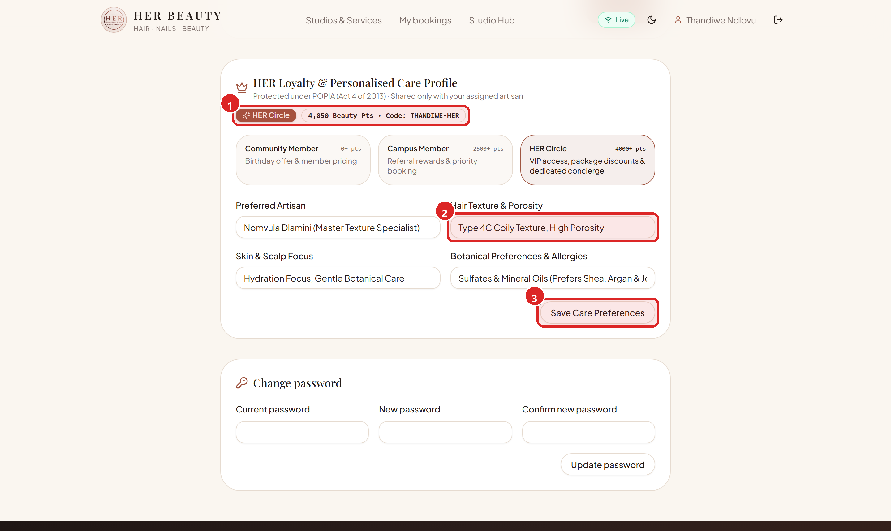

**✓ Verification Criteria (What You Should See):**
- ✓ Thandiwe's **HER Circle** VIP tier (**4,850 Beauty Pts · Code: HER-THANDI**) highlights as active.
- ✓ Saved texture, skin, and allergy preferences confirm with a green success message.
- ⚠ *Helpful Note:* Your care profile is protected under POPIA and shared only with your assigned HER Beauty artisan.

---

## Master Test Sign-Off Matrix

| Test # | Role Group | Test Case Title | Expected Visual Result | Pass | Fail | Tester Notes |
| :--- | :--- | :--- | :--- | :---: | :---: | :--- |
| **M-01** | Platform Master | Login as Platform Master | ✓ You sign in without any error message on screen. | ☐ | ☐ | |
| **M-02** | Platform Master | Review Master Console & HER Pathway | ✓ You see **HER Beauty Master Control Center** under **Mrs Monean N Jacobs**. | ☐ | ☐ | |
| **M-03** | Platform Master | Create a New Studio Hub | ✓ The **Onboard New Business Tenant** window opens cleanly over the page. | ☐ | ☐ | |
| **M-04** | Platform Master | Manage Studio Directory & Status | ✓ All 6 HER Beauty hubs appear with green **Active** badges. | ☐ | ☐ | |
| **M-05** | Platform Master | Step Into a Studio & Return Safely | ✓ The top bar clearly reads **Impersonating: HER Beauty — Flagship Studio**. | ☐ | ☐ | |
| **M-06** | Platform Master | Switch Roles in Platform Simulator | ✓ Five role cards appear covering Director, Studio Manager, Head Mentor, Campus Hub, and VIP Client. | ☐ | ☐ | |
| **M-07** | Platform Master | Inspect Activity History & Governance Log | ✓ The **Immutable Audit Trail** lists bookings, role switches, and studio updates. | ☐ | ☐ | |
| **M-08** | Platform Master | Verify Platform Master Account & Profile (Mrs Monean N Jacobs) | ✓ **founder@herbeauty.co.za** signs in with full **MASTER** executive privileges. | ☐ | ☐ | |
| **D-01** | Studio Director | Login as Flagship Studio Director | ✓ You sign in smoothly as **Chloe Laurent** for **HER Beauty — Flagship Studio**. | ☐ | ☐ | |
| **D-02** | Studio Director | Review Studio Dashboard & Today's Schedule | ✓ You see **HER Beauty — Flagship Studio** and all four performance cards. | ☐ | ☐ | |
| **D-03** | Studio Director | Confirm & Manage Client Bookings | ✓ Appointments filter cleanly by status pill. | ☐ | ☐ | |
| **D-04** | Studio Director | Manage Services & 5 Revenue Streams | ✓ Flagship Studio lists **21 services** across hair, braids, wigs, gel nails, facials, kits, and events. | ☐ | ☐ | |
| **D-05** | Studio Director | Manage Artisans & HER Pathway Stages | ✓ All 5 Flagship artisans appear across **EMPOWER (50%)**, **GROW (45%)**, **EARN (40%)**, **PRACTISE (35%)**, and **LEARN (30%)**. | ☐ | ☐ | |
| **D-06** | Studio Director | Open Studio Chair Time Slots | ✓ The **Open up time slots** tool splits your chosen hours into bookable appointment slots. | ☐ | ☐ | |
| **D-07** | Studio Director | Publish Specials & Send Broadcasts | ✓ All active campus specials display discount percentages and validity dates. | ☐ | ☐ | |
| **D-08** | Studio Director | Verify Artisan Contracts, Cohort 2025 & POPIA | ✓ Policy terms clearly show **20% deposit**, **24 hrs** cancellation, **50%** no-show fee, and **14 days** retail return. | ☐ | ☐ | |
| **D-09** | Studio Director | Update Studio Profile & Public Visibility | ✓ The studio shows **Taking bookings** so clients can discover it in search. | ☐ | ☐ | |
| **A-01** | Artisan & Mentor | Login as Head Mentor & Master Stylist | ✓ You sign in as **Nomvula Dlamini** (Master Stylist & Senior Mentor). | ☐ | ☐ | |
| **A-02** | Artisan & Mentor | Check Daily Chair Schedule & Live Updates | ✓ Your assigned client appointment shows exact time (**10:00 AM–11:15 AM**), service, and client notes. | ☐ | ☐ | |
| **A-03** | Artisan & Mentor | Confirm & Complete Chair Appointments | ✓ Pending appointments (**HER-84922**) show clear **Confirm** and **Cancel** buttons. | ☐ | ☐ | |
| **A-04** | Artisan & Mentor | Verify Pathway Stage & Commission Tier | ✓ **Nomvula Dlamini** displays **EMPOWER** stage at **50% comm.** | ☐ | ☐ | |
| **A-05** | Artisan & Mentor | Publish Open Chair Slots for Clients | ✓ New 30-minute or 60-minute slots appear immediately in the open slots grid below. | ☐ | ☐ | |
| **A-06** | Artisan & Mentor | Review Stylist Notices & Specials | ✓ Stylist notices (such as **Updated Young Stylist Mentorship & Saturday Shift Rosters**) are visible. | ☐ | ☐ | |
| **A-07** | Artisan & Mentor | Check Artisan Contract & Mentorship Hours | ✓ Cohort 2025 shows mentors (**Nomvula Dlamini**, **Zanele Khumalo**) and enrolled fellows. | ☐ | ☐ | |
| **A-08** | Artisan & Mentor | Verify Public Artisan Portfolio & Badge | ✓ Each artisan's photo, bio, specialties, star rating (**4.9+**), and **HER Pathway** badge appear proudly. | ☐ | ☐ | |
| **C-01** | Client & Student | Browse Studios & Glow-Up Banner | ✓ The luxury **HER Beauty** home page loads with the **GLOW20** special privilege banner. | ☐ | ☐ | |
| **C-02** | Client & Student | Explore Flagship Studio & ZAR Menu | ✓ Opening hours (**Mon–Fri 08:30–18:00, Sat 09:00–16:00**), phone (**081 047 0327**), and ZAR prices appear. | ☐ | ☐ | |
| **C-03** | Client & Student | Login as VIP Student Client | ✓ You sign in as **Thandiwe Ndlovu**. | ☐ | ☐ | |
| **C-04** | Client & Student | Booking Step 1: Choose a Service | ✓ Your chosen service card highlights with a checkmark. | ☐ | ☐ | |
| **C-05** | Client & Student | Booking Step 2: Select Preferred Artisan | ✓ **Nomvula Dlamini** shows a selected checkmark and her **EMPOWER** badge. | ☐ | ☐ | |
| **C-06** | Client & Student | Booking Step 3: Pick Date & Chair Slot | ✓ Only genuinely open chair times appear — already-booked times are hidden. | ☐ | ☐ | |
| **C-07** | Client & Student | Booking Step 4: Apply Promo & Accept POPIA | ✓ Price updates automatically from **R 320** to **R 256 (20% off with CAMPUS20)**. | ☐ | ☐ | |
| **C-08** | Client & Student | Verify Booking Receipt & Reference Code | ✓ A unique **HER-** reference code is generated immediately. | ☐ | ☐ | |
| **C-09** | Client & Student | Check My Bookings & HER Circle Loyalty | ✓ Thandiwe's **HER Circle** VIP tier (**4,850 Beauty Pts · Code: HER-THANDI**) highlights as active. | ☐ | ☐ | |

### Final Stakeholder Approval
- **Tester Full Name:** ________________________________________
- **Role / Department:** _______________________________________
- **Signature:** _______________________________________________
- **Date Tested:** ____________________ *(Pack issued 18 April 2026)*
- **Decision:** ☐ **APPROVED FOR LIVE USE**    ☐ **CHANGES NEEDED**
